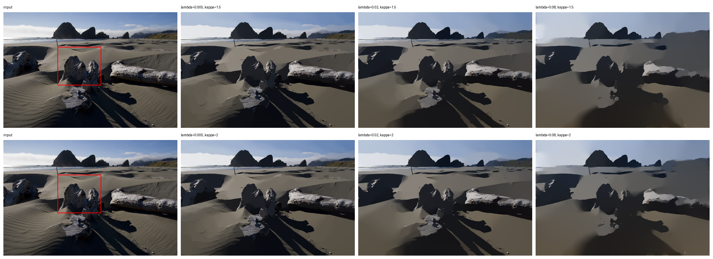
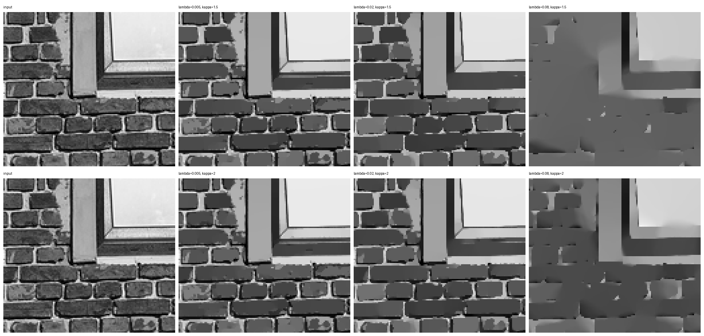
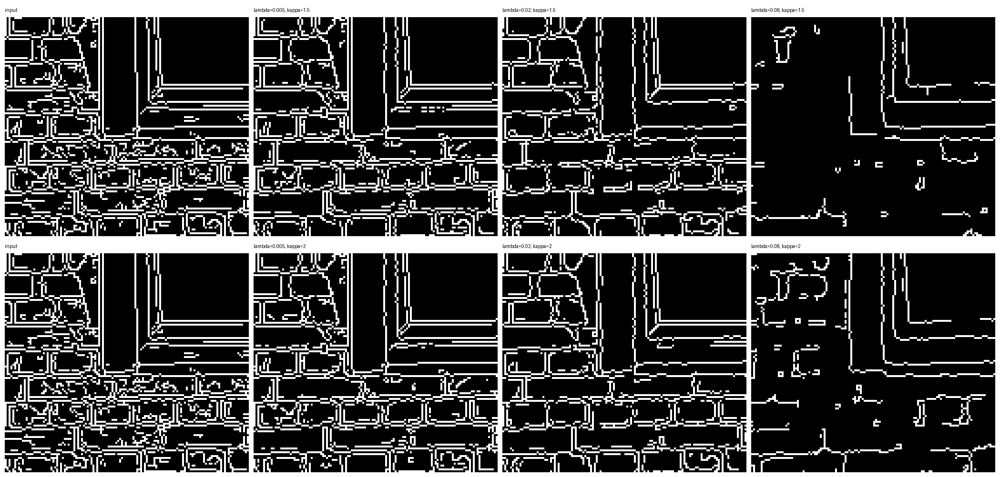
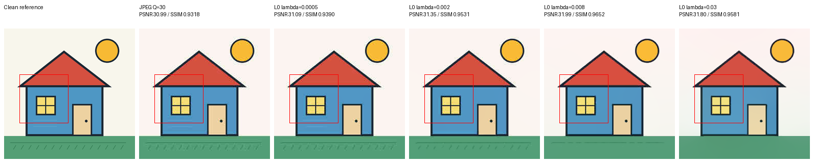
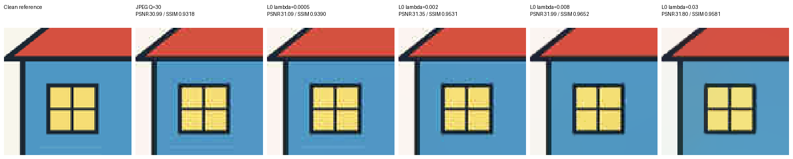
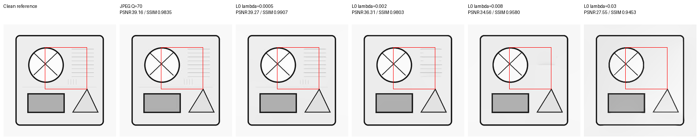

# L0 梯度最小化图像结构平滑、边缘提取与 Clip-art JPEG 去伪影

媒体计算课程第 4 题课程报告可用稿。整理日期：2026-11-17—18。

| 成员 | 课程登记信息 | 本项目任务 |
| --- | --- | --- |
| 成员 A | 姓名、学号待本人填写；不以 Git 作者身份代替课程登记 | L0 核心、图像读写与复现、多图参数实验、固定参数 Canny 对照 |
| 成员 B | 蒋天乐，2023010721 | Clip-art JPEG 去伪影、PSNR/SSIM 与局部对照、Demo、报告与展示材料整合 |

本文依据仓库实际代码、CSV、JSON、图像和智能体重新执行的验证记录整理。成员 A 的历史工作以已有文件及 Git 记录为依据；本轮没有补造此前对话或个人理解过程。两位成员的算法理解、人工核验和课堂展示仍须本人完成。课程评分依据沿用 [课程要求摘录](requirements.md)，本轮工作区未附三份课程原始 PDF，没有声称重新逐页核对原件。

## 1. 项目目标与完成范围

本项目自行实现 *Image Smoothing via L0 Gradient Minimization* 的核心步骤，通过减少非零梯度的位置，压低细纹理并保留主要边界；在此基础上完成同参边缘对照和 Clip-art JPEG 压缩伪影处理。这两类应用与论文作者项目页介绍的用途一致。[论文作者项目与论文入口](https://jiaya.me/file/archive/projects/L0smoothing/)

现有证据包括三幅图像的 18 组 λ×κ 结构平滑、21 张同参 Canny 边缘图、两幅干净几何 Clip-art 的 6 个 JPEG 输入与 24 组 L0 恢复、30 行全图及局部指标，以及可运行 CLI 和离线 Demo。效果下降的结果保留在同一网格中。上述是功能产物和智能体检查结果，不等于课程验收或已经获得相应分数。

## 2. 算法原理与实现

### 2.1 目标函数与数据约定

输入 I 为归一化到 [0,1] 的 float64 灰度 H×W 或 RGB H×W×3 数组，输出 S 与输入同尺寸。令 c 表示通道，p 表示像素位置，目标为：

```text
min_S  Σ_(p,c) (S_(p,c) − I_(p,c))² + λ C(S)
C(S) = #{ p : Σ_c (|Dx S_(p,c)| + |Dy S_(p,c)|) ≠ 0 }
```

计数单位是像素位置：同一位置的两个方向和全部颜色通道联合决定是否计数，不是分别累加 RGB 三个非零数。保真项抑制 S 偏离输入；λ 增大更强地惩罚非零梯度位置，通常更容易消除细小结构，也可能清除有意义的细线。它不是直接缩小每条梯度幅度的 L2 梯度惩罚。

### 2.2 周期差分、辅助变量与联合阈值

采用周期前向差分，图像最右列接最左列、最下行接最上行：

```text
Dx S[y,x] = S[y,(x+1) mod W] − S[y,x]
Dy S[y,x] = S[(y+1) mod H,x] − S[y,x]
Dx* h[y,x] = h[y,(x−1) mod W] − h[y,x]
Dy* v[y,x] = v[(y−1) mod H,x] − v[y,x]
```

引入 h、v 后，固定 β 的辅助目标明确为：

```text
||S−I||² + λ #{p : Σ_c(h_(p,c)²+v_(p,c)²)>0}
         + β(||DxS−h||² + ||DyS−v||²)
```

交替更新图像和辅助变量。固定 S，令 q_p=Σ_c((DxS)²+(DyS)²)：若 q_p≤λ/β，同一位置的 h、v 的全部通道置零；否则保留两个方向的原梯度。等号属于代价相同的情形，实现选择置零。彩色图像因此使用同一掩码，灰度是单通道特例。

### 2.3 FFT 闭式更新与停止条件

固定 h、v 后，S 的子问题是二次问题：

```text
(Id + β(Dx*Dx + Dy*Dy))S = I + β(Dx*h + Dy*v)
d_x(k) = exp(+2π i k/W) − 1
d_y(l) = exp(+2π i l/H) − 1
F(S) = [F(I) + β(conj(d_x)F(h) + conj(d_y)F(v))]
       / [1 + β(|d_x|² + |d_y|²)]
```

使用周期边界才能按上述频率响应逐点相除。伴随在频域对应共轭，避免把前向差分与散度符号混用。各通道分别求解，逆 FFT 后取实部。NumPy 的正变换采用负指数，因此本实现前向移位差分的响应写作正指数。[NumPy FFT 官方文档](https://numpy.org/doc/stable/reference/routines.fft.html)

流程为 S=I、β=2λ；当 β<βmax 时，先更新 h/v，再更新 S，随后 β←κβ；达到 β≥βmax 时停止。本文所有实验 βmax=100000。参数要求 λ>0、κ>1、βmax>2λ，保证至少执行一轮。κ 控制 β 的增长步幅，改变迭代次数和优化路径。该问题非凸，交替优化不保证找到全局最优，也不保证 PSNR 单调提高。每轮主要 FFT 计算量约 O(CHW log(HW))，主要数组空间约 O(CHW)。

### 2.4 代码对应与保存方式

| 实现步骤 | 本组代码 |
| --- | --- |
| 形状、参数、值域验证及 β 循环 | `l0_smoothing/core.py:smooth_l0` |
| 周期差分及彩色联合阈值 | `_periodic_forward_differences`、`_threshold_gradients` |
| 差分频率响应及闭式更新 | `_frequency_responses`、`_fft_update` |
| 图像读取、保存和重跑比较 | `l0_smoothing/workflow.py` |
| JPEG 编码、参数网格、全图及局部对照 | `scripts/jpeg_artifacts.py` |
| 明确口径的 PSNR/SSIM | `l0_smoothing/metrics.py` |
| 实际运行并生成离线页 | `scripts/demo.py` |

核心由本组仓库代码完成，没有用作者代码或现成完整 L0 接口代替。第三方库用于数组、FFT、图像编解码和基本检测。`output.npy` 保存未裁剪 float64；`output.png` 仅为显示时裁剪到 [0,1]、乘 255 并四舍五入的 uint8 副本。每次新建结果目录，保留输入副本、SHA-256、参数、迭代数、环境和实际耗时。

## 3. 数据、来源与实验设计

### 3.1 基础结构平滑数据

下表来源与许可依据成员 A 归档的 [数据说明和清单](../data/structure_smoothing/README.md)。本轮核对三份原件及三份输入 SHA-256 一致，没有重新下载替换。

| 图像 | 来源与许可 | 实际预处理 |
| --- | --- | --- |
| beach | [论文官网 Input Images](https://jiaya.me/file/archive/projects/L0smoothing/ImageSmoothing.htm)；官网未注明图片作者和许可，授权状态仍待核实 | 800×533 RGB，经 EXIF 方向处理、RGB 转换，LANCZOS 等比例缩至 512×341，PNG |
| brick_window_gray | [Tarasna0922，Brick wall and window.jpg](https://commons.wikimedia.org/wiki/File:Brick_wall_and_window.jpg)，[CC BY-SA 4.0](https://creativecommons.org/licenses/by-sa/4.0/) | 3225×2200 RGB，处理 EXIF 后转 L，缩至 512×349；灰度、缩放和平滑为改作，保留同许可及署名 |
| sunflower | [Timovn，Sunflower in a field.jpg](https://commons.wikimedia.org/wiki/File:Sunflower_in_a_field.jpg)，[CC BY 4.0](https://creativecommons.org/licenses/by/4.0/) | 4608×3456 RGB，处理 EXIF 后保留 RGB，缩至 512×384；注明缩放和平滑改动 |

没有裁剪原始输入或拉伸对比度。三图用于观察沙纹/木头轮廓、砖面颗粒/窗框、花盘草地纹理/花瓣边界，不存在干净去噪真值，故不把它们相对原图的 PSNR 称作恢复质量。

### 3.2 JPEG 干净输入和编码

`house_rgb` 与 `line_gray` 均为本轮智能体编写 Pillow 程序确定性绘制的 256×256 几何图；不是蒋天乐手绘、外部下载、论文恢复图或已有真实照片。生成源为 `scripts/jpeg_artifacts.py:draw_clean`，固定坐标、无随机过程，在 3 倍画布绘制后用 LANCZOS 缩回。RGB 小屋有色块、斜屋顶、窗框和低对比装饰线；灰度图有粗轮廓及细灰线，用于检查过平滑失败。干净 PNG 从未先做 JPEG 编码，详见 [生成清单](../data/jpeg_artifacts/manifest.json)。

每幅干净 PNG 分别编码真实 JPEG，质量 Q∈{10,30,70}。Pillow 的 `optimize=False`、`progressive=False`；RGB 明确 `subsampling=0`（4:4:4），灰度无色度子采样。实验记录实际量化表、编码库版本、字节数及摘要；Q 是编码器参数，不是跨库统一的客观质量值。[Pillow JPEG 官方说明](https://pillow.readthedocs.io/en/stable/handbook/image-file-formats.html#jpeg)

### 3.3 固定参数与比较区域

| 实验 | 参数与运行数 |
| --- | --- |
| 基础结构平滑 | 3 图×λ∈{0.005,0.02,0.08}×κ∈{1.5,2}，βmax=100000，共18组 |
| Canny 对照 | 3 原图+18 平滑 PNG，共21张；阈值60/120、Sobel孔径3、L2梯度；RGB统一 `COLOR_RGB2GRAY`，L不变，无额外模糊 |
| JPEG 去伪影 | 2 图×Q∈{10,30,70}×λ∈{0.0005,0.002,0.008,0.03}，κ=2、βmax=100000，共24组；另6行JPEG基线 |
| JPEG 局部 | house `[30,90,126,186]`；line `[94,52,190,148]`，均为xyxy、右/下边界不含；96×96区域，在生成时固定 |

Canny 的阈值、孔径与 L2 选项依据接口定义使用；本组对原图与平滑图保持完全相同设置。这里的边缘检测参数与 L0 的 λ、κ 分别记录。[OpenCV Canny 官方文档](https://docs.opencv.org/4.x/da/d22/tutorial_py_canny.html)

所有组都纳入 CSV；没有按指标删掉负例。局部在所有质量和 λ 下相同，以最近邻放大便于看像素。基础图局部坐标见各 `roi.json`。JPEG 局部对照图标题沿用全图指标，真正局部数值见 `roi_psnr_db`、`roi_ssim` 列和本文表格。

## 4. 指标定义

JPEG 与恢复图都以同一干净 PNG 为参考。主表使用解码 JPEG 或保存的 uint8 `output.png`，在编码像素域比较，不先转线性 RGB；未裁剪 `.npy` 另行保留，未与 uint8 主表混用。N 为所有像素和通道样本总数：

```text
MSE = (1/N) Σ_j (clean_j − candidate_j)²
PSNR = 10 log10(255² / MSE)  dB
SSIM(x,y) = [(2μxμy+C1)(2σxy+C2)]
            / [(μx²+μy²+C1)(σx²+σy²+C2)]
C1=(0.01×255)², C2=(0.03×255)²
```

PSNR 越大表示本口径的均方误差越小，完全相同时为正无穷。SSIM 使用归一化 11×11 高斯窗、σ=1.5、加权总体矩；只统计完整窗口落在图内的中心，丢弃四周5像素。RGB 的 SSIM 为三个通道分数的算术平均，不转亮度、不下采样；这是本项目明确采用的单尺度约定，不能与亮度 SSIM 或多尺度 SSIM 数值直接混比。局部先按固定 ROI 裁剪，再独立计算同样指标与有效边界。[SSIM 作者说明及原论文入口](https://ece.uwaterloo.ca/~z70wang/research/ssim/)

实现用 OpenCV 高斯滤波计算矩，另以独立 NumPy 权重和有效域卷积重算全部30行全图/局部指标：PSNR 差0，SSIM最大绝对差约2.052×10⁻¹³，见 [独立核对记录](../results/member_b_verification/jpeg-independent-20261117T155211Z/audit.md)。这验证计算一致性，不替代人对真实细节和伪影的观察。

## 5. 结果与分析

### 5.1 结构平滑与参数影响

图1为沙滩全图，两行分别 κ=1.5、2，列为原图及 λ=0.005、0.02、0.08。沙纹在适中参数下减少，岩石和木头主体边界仍在；λ=0.08 的木头细轮廓及沙丘层次损失明显。以下观察由智能体实际查看归档图像，成员本人仍须核对。



图2中，λ=0.005 压低砖面颗粒，窗框及多数砖缝仍可辨；λ=0.08 大量砖缝被合并，属于保留的失败例。向日葵同样在 λ=0.08 时花盘接近单色块，花瓣内部结构大量丢失。



固定 κ=2，各组相对原图的平均绝对变化量及 Canny 边缘像素数如下。变化量按未裁剪 `[0,1]` float64 全像素平均计算，表中保留6位；它衡量改动大小，不是质量指标。

| 图像 | 原图边缘数 | λ=0.005：变化量/边缘数 | λ=0.02：变化量/边缘数 | λ=0.08：变化量/边缘数 |
| --- | --- | --- | --- | --- |
| beach | 14968 | 0.017610 / 11608 | 0.034063 / 8380 | 0.058889 / 4439 |
| brick_window_gray | 43495 | 0.025242 / 35949 | 0.051037 / 27792 | 0.106586 / 10604 |
| sunflower | 41729 | 0.014936 / 37416 | 0.037698 / 26268 | 0.082296 / 7294 |

λ 增大时图像改动和边缘减少更明显，但图2说明边缘少不等于轮廓更正确。图3用完全相同 Canny 参数展示窗框与砖缝的保留及损失。



| λ | κ=1.5迭代数 | κ=2迭代数 |
| --- | --- | --- |
| 0.005 | 40 | 24 |
| 0.02 | 37 | 22 |
| 0.08 | 33 | 20 |

κ=2 在同一旧环境下迭代更少、这组图的实测耗时也更低，但输出亦改变：灰度砖墙 λ=0.08 的两种 κ 结果平均绝对差为0.042986（[0,1]），局部砖缝残留不同。λ更大时迭代数较少，是初始 β=2λ 更大的结果，不代表每次迭代惩罚更弱。完整18组参数与耗时见 [runs.csv](../results/structure_smoothing/experiment-20261117T102719Z-1b827758b270/runs.csv)。

### 5.2 JPEG 去伪影：改善与损失并存

图4、图5为 house Q30：左起干净真值、JPEG、λ=0.0005/0.002/0.008/0.03，κ固定2。JPEG 在斜屋顶、窗框周围和平坦墙面出现振铃、条纹及分块变化；λ=0.008 后这些变化明显减弱，主体屋顶和窗框仍可辨。λ=0.03 更平整，却也进一步抹掉干净图本来存在的浅色装饰线。不能仅凭平坦程度判定恢复质量。





代表改善和负例的定量比较如下；完整30行见附录，数值四舍五入。

| 输入/处理 | 全图PSNR/dB | 全图SSIM | 局部PSNR/dB | 局部SSIM |
| --- | --- | --- | --- | --- |
| house Q30 JPEG | 30.9931 | 0.931767 | 28.6654 | 0.896815 |
| house Q30 λ=0.008 | 31.9893 | 0.965178 | 30.1149 | 0.962119 |
| house Q30 λ=0.03 | 31.8000 | 0.958101 | 30.4423 | 0.976340 |
| line Q70 JPEG | 39.1555 | 0.983487 | 35.7005 | 0.962835 |
| line Q70 λ=0.0005 | 39.2742 | 0.990718 | 36.1243 | 0.976087 |
| line Q70 λ=0.03 | 27.5480 | 0.945320 | 28.1140 | 0.814657 |

house Q30 λ=0.008 的全图 PSNR 提高约0.9962 dB，局部提高约1.4496 dB；λ=0.03 的局部指标继续上升但全图指标下降，说明局部好转不能代表整图最优。不同质量所需强度不同：house Q70 在 λ=0.002 时全图 PSNR为36.0110 dB，比 λ=0.03 的33.6684 dB更高；较干净的输入通常不需要同样强的平滑。

图6为 line Q70 的负例。λ=0.03 时粗圆框、矩形仍在，右侧真实的低对比灰线却消失；全图 PSNR相对JPEG下降约11.6075 dB。低幅度真细节与压缩伪影都会被稀疏化机制抑制，单用 L0 不能可靠区分二者。



24组恢复中，8组全图PSNR下降、5组全图SSIM下降。还有指标方向不一致的情形：line Q10 λ=0.03 的PSNR从28.7667降至28.3791 dB，但SSIM从0.921230升至0.948725；line Q10 λ=0.008 全图指标高于JPEG，局部PSNR/SSIM却低于JPEG。这些现象要求同时查看真值、全图、局部和两类指标，不能择一宣称全面改善。本实验没有测试集，按每图真值挑选最优 λ 只用于描述这组数据，不能当作未知输入的自动选参方法。

### 5.3 耗时与环境边界

| 记录环境 | 实际版本 | 耗时范围/示例 |
| --- | --- | --- |
| 成员A归档环境 | Windows 11；Python3.13.14、NumPy2.5.4、Pillow13.0.0、opencv-python-headless5.0.0.93；版本按原JSON记录 | 18组基础核心0.590256–2.934886秒 |
| 成员B本轮验证环境 | WSL2 Linux；Python3.10.12、NumPy2.2.4、Pillow11.3.0、opencv-python4.13.0.92（cv2 4.13.0）、libjpeg6.2 | 24组JPEG核心约0.0576–0.3633秒；256×256灰度与RGB不直接混比 |
| 成员B完整Demo单次 | 同上；照片λ=0.02，JPEG Q30 λ=0.008 | 总2.221秒；照片核心0.858秒、JPEG核心0.253秒，其余含I/O、指标和HTML生成 |

没有控制机器硬件、后台负载或做重复计时统计，因此不据这些数值声称跨平台加速比。基础结果在当前环境抽查三组，核心耗时为1.547/0.309/1.320秒；误差与验证范围见下一节。旧环境版本仅是归档记录，本轮未重建该环境。

## 6. 运行、复现与 Demo

在项目根目录，用 Python3.10+ 建议创建独立环境。成员B依赖清单单独保留，避免替换成员A的原 `requirements.txt`：

```bash
python -m venv .venv
# Linux/WSL：source .venv/bin/activate
# Windows PowerShell：.venv\Scripts\Activate.ps1
python -m pip install -r requirements-member-b.txt
python -m unittest discover -s tests -v
python -m scripts.jpeg_artifacts prepare
python -m scripts.jpeg_artifacts run
python -m scripts.demo --mode all
```

主要实验使用机器已有依赖及 `/tmp/media-compute-venv/bin/python`；本轮又在独立 `/tmp/media-compute-clean` 环境安装 `requirements-member-b.txt` 的三个固定包，14项测试通过，完整Demo及其检查通过（14张内嵌图、两项核心复现均像素差0），真实结果见 [干净环境验证记录](../results/demo/clean_environment_verification.json)。这是Linux/WSL下的安装验证，Windows环境仍待本人检查。安装完成后，实验与 Demo 运行不联网。重新生成的目录名、耗时可不同；PNG/JPEG 编码跨库版本也可能不同，应优先复现归档输入副本。真实参数实验及检查命令：

```bash
python -m scripts.structure_smoothing_experiment check results/structure_smoothing/experiment-20261117T102719Z-1b827758b270
python -m scripts.edge_comparison check results/edge_comparison/edges-20261117T105442Z-a63edf132bc2
python -m scripts.jpeg_artifacts check results/jpeg_artifacts/jpeg-20261117T155122Z-e37cd961efa5
python results/member_b_verification/verify_existing.py
```

单图支持 `python -m l0_smoothing run <8位L或RGB文件> --output-dir <目录> --lambda 0.02 --kappa 2`；对实际打印的 `run.json` 执行 `python -m l0_smoothing replay <run.json> --output-dir <新目录>`。工作流先检查输入解码像素，再比较输出浮点绝对误差及显示像素；默认容差1e-12。Windows旧绝对来源路径只作记录，默认重跑使用相邻输入副本。

Demo 通过命令真实调用本组核心，生成包含原图、平滑、同参Canny、JPEG真值/压缩/恢复及局部指标的离线页。使用浏览器打开终端打印的 `index.html`；图像和样式内嵌，页面用于展示本次结果，改参数需重新运行CLI。照片与JPEG分别使用不同λ：

```bash
python -m scripts.demo --mode all --smooth-lambda 0.02 --jpeg-lambda 0.008 --quality 30
python -m scripts.demo --mode jpeg --clipart line_gray --quality 70 --lambda 0.03
python -m scripts.demo check results/demo/中文验证/demo-20261117T155441Z-d0d62b1d3d75
```

归档 [完整Demo](../results/demo/中文验证/demo-20261117T155441Z-d0d62b1d3d75/index.html) 包含14张内嵌图；总耗时及核心耗时见上表。参数、命令、环境和摘要在同目录 `demo.json`，智能体检查记录包括 `checks-20261117T155551Z-e7599afeabc2/checks.json`。还保留灰度单模式与JPEG失败例。详细说明见 [Demo运行说明](demo.md)。

本机没有图形浏览器；已验证CLI、HTML结构、内嵌图解码和数值重跑，没有声称完成浏览器视觉、投影适配、现场演示或录像。9分钟双人展示材料由本轮整理，现场操作与讲解由两位成员本人完成。课堂前应在展示电脑实际运行一次并打开离线页；失败时可打开归档页，说明它是预计算结果。

本报告的可打印HTML由 `docs/report.md` 生成，正文和6张图内嵌，无需服务器、脚本或远程样式。只有重新生成报告HTML才需可选文档依赖 `python -m pip install -r requirements-docs.txt`，再执行 `python -m scripts.render_report`；阅读报告和运行Demo无需 `markdown-it-py`。本轮渲染使用的真实版本及图像摘要见 `docs/report_render.json`，没有将可选文档依赖的全新安装声称为已验证。证据链接需连同仓库核查，不影响单独阅读HTML正文。

## 7. 验证、实际修正与局限

基础核对检查了18组输入摘要、float/显示一致性、CSV/JSON、参数和平均绝对变化量；21张Canny在当前环境全部重算像素一致。沙滩、灰度砖墙、向日葵各一组重跑，最大浮点误差分别为3.331e-15、1.395e-14、3.886e-15，显示像素差均0，均在原工作流容差内。不能将其写为跨环境浮点完全相同，也不能称18组都重新运行了核心。[基础审计证据](../results/member_b_verification/audit-20261117T155020560962Z/audit.md)

JPEG检查覆盖全部归档摘要和30行全图/局部指标，另有抽查核心复现。独立实现重算指标避免仅用同一函数自证。现有测试共14项，覆盖周期边界、RGB阈值等号、FFT与显式小线性系统、常量图、输入约束、读写/重跑和已知PSNR/SSIM值及独立窗口计算；14项在本轮独立安装环境中全部通过，记录见上述干净环境验证JSON，不能替代成员人工核验。

本轮实际修正包括：Demo单模式的βmax校验曾错误受到另一个未运行模式的默认λ影响，现只检查启用阶段；JPEG检查补强了对缺失/变化产物、CSV/JSON参数和浮点输出显示量化关系的核对；局部图标题明确为全图指标，局部指标另列。环境初建时缺少ensurepip，改用已有依赖建立验证环境；未把该失败命令当成安装成功。没有修改L0核心来迎合指标。更完整的失败及修正以 [AI日志](../AI_LOG.md) 和实际检查记录为准。

局限主要有：仅三幅基础图和两幅合成Clip-art，未覆盖复杂真实压缩、不同色度子采样或未知噪声；周期边界将图像两端相连，非周期内容可能受到边界影响；PSNR/SSIM受色域、量化、窗口和ROI影响；低幅度真细节与伪影难区分；没有作者输出逐像素对照，也没有独立测试集或全局最优保证。可以继续扩大真实数据、检查边界及不同JPEG设置，并研究不依赖干净真值的选参；这些属于后续工作，不写成已经完成。

## 8. 分工、AI 使用和提交状态

成员A在既有项目中负责核心、读写复现及基础两类实验，代码和Git历史予以保留。成员B蒋天乐提出剩余30分任务，并在本轮要求Agent实现JPEG实验、独立核对、Demo和文档。上述实现、绘图、运行和材料草稿由智能体执行；本报告没有把生成代码的过程改写成成员本人已独立编写，也没有把智能体图像观察改写成人工验收。

主Agent实际委派实验、独立审计、Demo和材料任务，再检查产物。关键验证由本轮运行记录支撑。AI使用者、实际工具、修正、验证和待补材料见共享 [AI_LOG.md](../AI_LOG.md)。无法取得的历史问答、模型标识、发问时刻和成员理解记录保持待补，不按现有代码倒推。

成员B已由本人确认使用 `蒋天乐 <jtl23@mails.tsinghua.edu.cn>` 提交，没有沿用成员A的Git身份。阶段1提交为 `40c574cd18b184d3e92687c483f39aa1569a549e`（2026-11-17T23:55:45+08:00，`实现Clip-art JPEG去伪影、指标实验与独立复核`）；阶段2为 `8c19f4bcb41e8b7ce17e5e316729ff9854875ae5`（2026-11-17T23:57:28+08:00，`增加三功能本地Demo与离线展示结果页`）。后续报告、展示材料、日志与历史导出的最终状态以交付核对表、AI日志和真实Git记录为准，报告不预写尚未完成的提交或推送。成员A课程登记姓名/学号、双方人工核验、旧AI问答及展示环境核验仍须本人补齐。

## 9. 参考来源与证据索引

1. Li Xu, Cewu Lu, Yi Xu, Jiaya Jia. *Image Smoothing via L0 Gradient Minimization*. ACM Transactions on Graphics, 2011. [作者项目页及论文](https://jiaya.me/file/archive/projects/L0smoothing/)。用于算法依据和输入来源，未调用作者核心代码。
2. Z. Wang, A. C. Bovik, H. R. Sheikh, E. P. Simoncelli. *Image Quality Assessment: From Error Visibility to Structural Similarity*. IEEE Transactions on Image Processing, 2004. [作者SSIM页面](https://ece.uwaterloo.ca/~z70wang/research/ssim/)。本文采用的颜色及边界约定另作明确说明。
3. [NumPy FFT](https://numpy.org/doc/stable/reference/routines.fft.html)、[Pillow JPEG](https://pillow.readthedocs.io/en/stable/handbook/image-file-formats.html#jpeg)、[OpenCV Canny](https://docs.opencv.org/4.x/da/d22/tutorial_py_canny.html)：用于基础计算、编解码和边缘检测。
4. 数据来源与改作署名：[基础图像清单](../data/structure_smoothing/README.md)、[JPEG合成输入清单](../data/jpeg_artifacts/manifest.json)。
5. 原始实验与局部观察：[结构平滑](../results/structure_smoothing/README.md)、[同参边缘](../results/edge_comparison/README.md)、[JPEG](../results/jpeg_artifacts/README.md)、[成员B接续核对](../results/member_b_verification/README.md)。

## 附录：JPEG 完整结果

以下30行由归档 `metrics.csv` 原值生成并四舍五入，完整精度、耗时和逐组文件路径仍在 [metrics.csv](../results/jpeg_artifacts/jpeg-20261117T155122Z-e37cd961efa5/metrics.csv)。所有行统一κ=2、βmax=100000；JPEG行不执行平滑。包含全部负例，没有只列每图最优结果。

| 图像 | Q | 处理λ | 全图PSNR/dB | 全图SSIM | 局部PSNR/dB | 局部SSIM |
| --- | --- | --- | --- | --- | --- | --- |
| house_rgb | 10 | JPEG | 27.1403 | 0.887815 | 24.9704 | 0.818834 |
| house_rgb | 10 | 0.0005 | 27.1471 | 0.888524 | 24.9802 | 0.820700 |
| house_rgb | 10 | 0.002 | 27.2649 | 0.899506 | 25.1194 | 0.836097 |
| house_rgb | 10 | 0.008 | 27.8787 | 0.931963 | 25.8745 | 0.913313 |
| house_rgb | 10 | 0.03 | 28.4001 | 0.949574 | 26.9631 | 0.957724 |
| house_rgb | 30 | JPEG | 30.9931 | 0.931767 | 28.6654 | 0.896815 |
| house_rgb | 30 | 0.0005 | 31.0869 | 0.939047 | 28.7567 | 0.905180 |
| house_rgb | 30 | 0.002 | 31.3545 | 0.953052 | 28.9890 | 0.926637 |
| house_rgb | 30 | 0.008 | 31.9893 | 0.965178 | 30.1149 | 0.962119 |
| house_rgb | 30 | 0.03 | 31.8000 | 0.958101 | 30.4423 | 0.976340 |
| house_rgb | 70 | JPEG | 35.3361 | 0.959576 | 33.1969 | 0.939642 |
| house_rgb | 70 | 0.0005 | 35.5341 | 0.967630 | 33.3322 | 0.948810 |
| house_rgb | 70 | 0.002 | 36.0110 | 0.976590 | 33.9989 | 0.965545 |
| house_rgb | 70 | 0.008 | 35.4857 | 0.975012 | 33.6593 | 0.981645 |
| house_rgb | 70 | 0.03 | 33.6684 | 0.960706 | 31.2569 | 0.979237 |
| line_gray | 10 | JPEG | 28.7667 | 0.921230 | 25.9472 | 0.826652 |
| line_gray | 10 | 0.0005 | 28.9146 | 0.927733 | 26.0355 | 0.837714 |
| line_gray | 10 | 0.002 | 29.3247 | 0.952271 | 26.1868 | 0.863495 |
| line_gray | 10 | 0.008 | 29.3713 | 0.947876 | 25.7941 | 0.803380 |
| line_gray | 10 | 0.03 | 28.3791 | 0.948725 | 25.4246 | 0.805125 |
| line_gray | 30 | JPEG | 33.4176 | 0.961250 | 30.5039 | 0.913199 |
| line_gray | 30 | 0.0005 | 33.5881 | 0.968787 | 30.6331 | 0.925883 |
| line_gray | 30 | 0.002 | 33.2416 | 0.971760 | 30.5496 | 0.901119 |
| line_gray | 30 | 0.008 | 32.8021 | 0.954318 | 29.1867 | 0.815399 |
| line_gray | 30 | 0.03 | 29.3266 | 0.949249 | 28.0630 | 0.813799 |
| line_gray | 70 | JPEG | 39.1555 | 0.983487 | 35.7005 | 0.962835 |
| line_gray | 70 | 0.0005 | 39.2742 | 0.990718 | 36.1243 | 0.976087 |
| line_gray | 70 | 0.002 | 36.3133 | 0.980262 | 34.1992 | 0.925430 |
| line_gray | 70 | 0.008 | 34.5582 | 0.958024 | 30.6774 | 0.828507 |
| line_gray | 70 | 0.03 | 27.5480 | 0.945320 | 28.1140 | 0.814657 |
